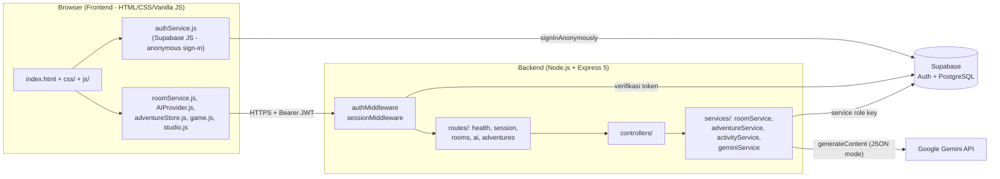
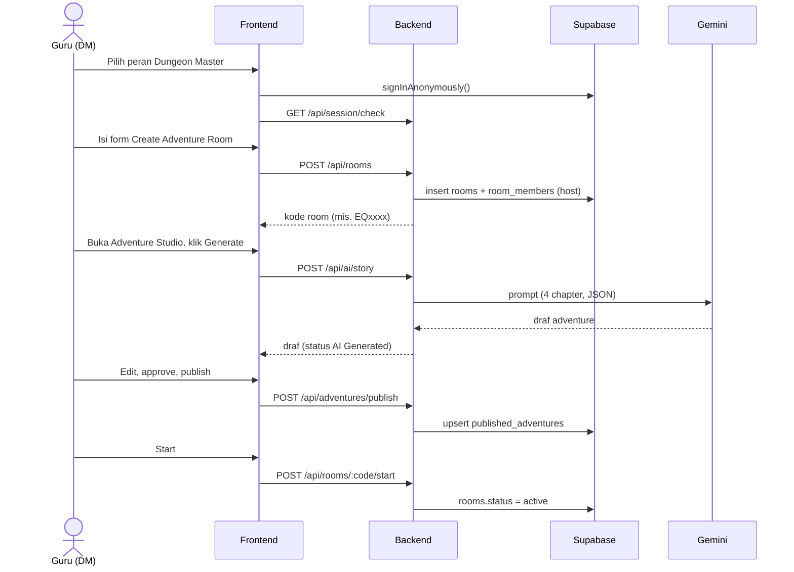
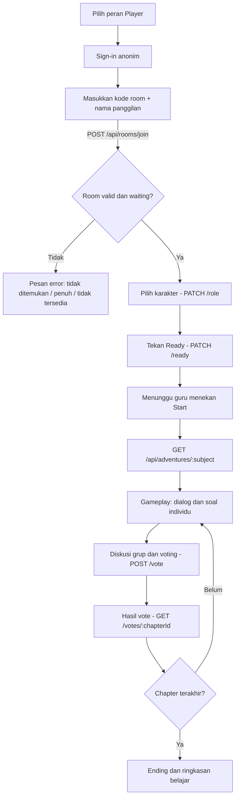

# EduQuest AI

**Belajar jadi petualangan.** EduQuest AI adalah platform pembelajaran berbasis cerita bergaya *Dungeon & Dragons*. Guru berperan sebagai **Dungeon Master**, siswa menjadi **Player** dengan karakter masing-masing, lalu bersama-sama menyelesaikan chapter cerita yang berisi soal, diskusi, dan voting. AI membantu guru menyusun cerita dan soal, tetapi **guru tetap memegang keputusan akhir**.

---

## 1. Pengenalan Projek

### Latar belakang
Siswa sering kehilangan motivasi karena latihan soal terasa monoton, sementara guru kesulitan menyiapkan materi yang menarik untuk setiap mata pelajaran dan jenjang.

### Solusi
EduQuest AI mengubah satu bab materi menjadi petualangan multiplayer di kelas:

| Peran | Yang dilakukan |
| --- | --- |
| **Dungeon Master (guru)** | Membuat *Adventure Room*, memilih mata pelajaran dan jenjang, menyusun/menyunting cerita di **Adventure Studio**, menyetujui draf AI, mengatur kapasitas, lalu memulai petualangan. |
| **Player (siswa)** | Bergabung dengan kode room, memilih karakter (Swordsman, Mage, Archer, Support), menjawab soal individu, berdiskusi dan **voting** keputusan cerita bersama kelompok. |
| **AI Dungeon Assistant** | Membuat **draf** adventure (4 chapter) dan soal lewat Gemini. Draf harus disetujui guru sebelum dipublikasikan. |

### Target pengguna
Guru dan siswa SD, SMP, SMA (Education Level: *Elementary, Junior High, Senior High*) pada mata pelajaran **Mathematics, Science, History, dan Language**.

### Fitur utama
- Pemilihan peran Dungeon Master / Player dan pembuatan room dengan kode unik.
- Lobby room: panel guru, kapasitas pemain, status *Ready*, pemilihan karakter.
- **Gameplay**: dialog, pergantian latar, soal individu (pilihan ganda / isian / skenario), diskusi grup, voting, recap, empat ending, ringkasan belajar.
- **Adventure Studio**: generate (AI), edit chapter, tambah/ubah/urutkan soal, persetujuan per chapter/soal, lalu publish. Status: `Draft → AI Generated → Needs Review → Approved → Published`.
- Autentikasi **anonim** (tanpa data pribadi) dengan sesi kedaluwarsa setelah 24 jam tidak aktif.
- Audio dengan kontrol volume/mute (placeholder sintetis; tidak autoplay).

---

## 2. Technical Documentation

### 2.1 Arsitektur sistem



**Prinsip rancangan**
- Frontend hanya memegang kunci **publik** (Supabase *publishable key*). Kunci rahasia (`SUPABASE_SERVICE_ROLE_KEY`, `GEMINI_API_KEY`) **hanya ada di backend**.
- Semua endpoint selain `/api/health` dilindungi token Supabase + pemeriksaan sesi 24 jam.
- AI hanya membuat *draf*; publish dan penilaian dikendalikan guru.

### 2.2 Alur program

**a. Alur guru (Dungeon Master)**



**b. Alur siswa (Player)**



### 2.3 Teknologi

| Lapisan | Teknologi |
| --- | --- |
| Frontend | HTML5, CSS3, JavaScript (vanilla, tanpa build), `@supabase/supabase-js` via CDN, Google Fonts |
| Backend | Node.js, Express 5, `cors`, `dotenv`, `@supabase/supabase-js` |
| Database & Auth | Supabase (PostgreSQL + Anonymous Auth) |
| AI | Google Gemini (REST, `responseMimeType: application/json`, dengan daftar model cadangan/fallback) |
| Deploy backend | Vercel (`backendUrl` di `js/config.js`) |

---

## 3. Frontend Documentation

### 3.1 Framework
Frontend dibangun dengan **HTML/CSS/JavaScript murni (vanilla)** tanpa langkah build, sehingga mudah dijalankan di perangkat mana pun. Semua skrip dimuat berurutan lewat tag `<script>` di `index.html`; setiap modul mengekspos objek/fungsi global. Struktur *service*, *store*, dan *mocks* sengaja dibuat sejajar dengan arsitektur React/TypeScript agar mudah dimigrasikan.

### 3.2 Struktur folder

```
index.html                 Satu halaman: home, modal, lobby, studio, gameplay
css/
  base.css  home.css  modals.css  room-lobby.css
  character-select.css  teacher.css  game.css
js/
  config.js                Konfigurasi runtime (backendUrl, Supabase publishable key, useAPI)
  types.js                 JSDoc types + ROLE_PERMISSIONS / can()
  state.js  utils.js  effects.js  modals.js
  home.js  roles.js        Pemilihan peran + form Create Room
  room-lobby.js            Lobby, party panel, Ready/Start
  character-select.js      Pemilihan karakter
  teacher.js               Teacher Panel + Dashboard
  studio.js                Adventure Studio (generate, edit, approve, publish)
  game.js                  Gameplay: dialog, soal, diskusi, voting, ending
  data/   characters.js, npcs.js
  mocks/  mockAdventures.js, mockStories.js, mockTeacher.js, mockRooms.js
  services/
    authService.js         Sign-in anonim Supabase + cek sesi backend
    roomService.js         Klien REST untuk /api/rooms
    AIProvider.js          Interface AI: MockAIProvider + APIAIProvider (memanggil /api/ai)
    adventureStore.js      Penyimpanan dan status adventure
    storyEngine.js         Guru mengarahkan cerita, AI hanya menyarankan
    learningEngine.js      Tantangan dan penjelasan
    sceneManager.js        Scene: lokasi, background, karakter, dialog, pilihan
    backgroundManager.js   Memetakan scene ke aset latar (ada fallback gradient)
    audioManager.js        Musik/SFX, volume, mute
assets/
  characters/  4 karakter (swordsman, mage, archer, support)
  backgrounds/ latar (castle, forest, kingdom, library, cave, temple, dll.)
  npcs/        ilustrasi NPC (PNG + SVG)
tools/
  make_backgrounds.py      Pembuat latar SVG orisinal
  make_npcs.py             Pembuat ilustrasi NPC
```

### 3.3 Komponen dan tanggung jawab

| Komponen | Berkas | Fungsi |
| --- | --- | --- |
| Role Selection & Create Room | `roles.js`, `home.js` | Memilih peran, membuat/bergabung room |
| Room Lobby | `room-lobby.js` | Daftar pemain, Ready, Start, undangan |
| Character Select | `character-select.js`, `data/characters.js` | Memilih karakter dan kemampuan |
| Teacher Panel & Dashboard | `teacher.js` | Kapasitas, kelola siswa, ringkasan |
| Adventure Studio | `studio.js`, `adventureStore.js` | Alur Draft → Published |
| Gameplay | `game.js`, `sceneManager.js`, `backgroundManager.js` | Dialog, soal, voting, ending |
| Layanan jaringan | `roomService.js`, `AIProvider.js`, `authService.js` | Komunikasi dengan backend dan Supabase |

### 3.4 Aset dan atribusi
- Gambar karakter dan latar disimpan di `assets/`. Latar SVG dibuat oleh `tools/make_backgrounds.py`.
- Font: Google Fonts (dimuat saat online).
- Pustaka pihak ketiga: `@supabase/supabase-js` (MIT). Cantumkan sumber/lisensi setiap aset di luar karya tim pada kolom `credit` di `backgroundManager.js`.

### 3.5 Konfigurasi frontend (`js/config.js`)

| Kunci | Fungsi |
| --- | --- |
| `backendUrl` | Alamat backend (produksi: Vercel; lokal: `http://localhost:3000`) |
| `supabaseUrl`, `supabasePublishableKey` | Kunci **publik** Supabase untuk sign-in anonim |
| `useAPI` | `false` = AI mock di browser; `true` = pakai backend/Gemini |

> Jangan pernah menaruh `GEMINI_API_KEY` atau `SUPABASE_SERVICE_ROLE_KEY` di berkas frontend.

---

## 4. Backend Documentation

### 4.1 Struktur

```
backend/
  package.json
  .env.example
  src/
    server.js                 Entry point Express
    config/                   supabase.js (anon), adminSupabase.js (service role)
    middleware/               authMiddleware.js, sessionMiddleware.js
    routes/                   health, session, rooms, ai, adventures
    controllers/              roomController, aiController, adventureController
    services/                 roomService, adventureService, activityService, geminiService
```

### 4.2 Autentikasi
Setiap permintaan (kecuali health check) harus membawa header:

```
Authorization: Bearer <access_token Supabase anonim>
```

1. `authMiddleware` memverifikasi token lewat `supabase.auth.getUser`.
2. `sessionMiddleware` memeriksa tabel `anonymous_activity`; jika tidak aktif ≥ 24 jam, backend menjawab `401 SESSION_EXPIRED`.

### 4.3 API Endpoints

Base URL lokal: `http://localhost:3000`

| Method | Endpoint | Auth | Deskripsi |
| --- | --- | :-: | --- |
| GET | `/api/health` | - | Cek server berjalan |
| GET | `/api/supabase-test` | - | Uji koneksi ke Supabase |
| GET | `/api/session/check` | ✔ | Cek sesi anonim masih valid |
| POST | `/api/rooms` | ✔ | Buat room (guru jadi host). Body: `name, nick, max (2-24), min, level, subject, chapter, chapterTitle, mode, objectives` |
| POST | `/api/rooms/join` | ✔ | Gabung room. Body: `code, nick`. Error: 404 tidak ditemukan, 409 penuh/tidak tersedia |
| GET | `/api/rooms/:code` | ✔ | Pulihkan data room |
| PATCH | `/api/rooms/:code/role` | ✔ | Pilih karakter. Body: `role` |
| PATCH | `/api/rooms/:code/ready` | ✔ | Ubah status siap. Body: `isReady` |
| POST | `/api/rooms/:code/start` | ✔ | Mulai petualangan (hanya Dungeon Master) |
| POST | `/api/rooms/:code/vote` | ✔ | Kirim/ubah suara (hanya Player). Body: `chapterId, optionId` |
| GET | `/api/rooms/:code/votes/:chapterId` | ✔ | Hasil voting: `counts`, `totalVotes`, `totalPlayers` |
| POST | `/api/ai/story` | ✔ | Buat draf adventure **tepat 4 chapter** lewat Gemini. Body: `subject` |
| POST | `/api/ai/questions` | ✔ | Buat soal. Body: `subject, count, difficulty` |
| POST | `/api/adventures/publish` | ✔ | Publikasikan adventure. Body: `subject, adventure` (status harus `Published`) |
| GET | `/api/adventures/:subject` | ✔ | Ambil adventure yang sudah dipublikasikan (404 bila belum ada) |

**Format error** (JSON): `{ "error": "pesan" }`. Kode umum: `400` input tidak valid, `401` token/sesi tidak valid, `403` bukan anggota/bukan host, `404` tidak ditemukan, `409` konflik (room penuh/tidak tersedia), `500` kesalahan server.

### 4.4 Skema database (Supabase / PostgreSQL)

> Skema di bawah disimpulkan dari kueri pada `backend/src`. Sesuaikan tipe dan *constraint* dengan proyek Supabase tim.

```sql
-- Aktivitas sesi anonim (untuk kedaluwarsa 24 jam)
create table anonymous_activity (
  user_id      uuid primary key,          -- auth.users.id
  last_seen_at timestamptz not null default now()
);

-- Room petualangan
create table rooms (
  id            uuid primary key default gen_random_uuid(),
  code          text unique not null,     -- kode room
  name          text not null,
  created_by    uuid not null,            -- guru (auth.users.id)
  max_players   int  not null,
  min_players   int  not null,
  level         text,                     -- Elementary | Junior High | Senior High
  subject       text,                     -- Mathematics | Science | History | Language
  chapter       text,
  chapter_title text,
  mode          text,                     -- teacher | ai
  objectives    text,
  status        text not null default 'waiting',   -- waiting | active
  game_state    jsonb,
  created_at    timestamptz not null default now()
);

-- Anggota room
create table room_members (
  room_id      uuid references rooms(id) on delete cascade,
  user_id      uuid not null,
  display_name text not null,
  role         text,                      -- swordsman | mage | archer | support
  is_host      boolean not null default false,
  is_ready     boolean not null default false,
  primary key (room_id, user_id)
);

-- Suara voting per chapter
create table room_votes (
  room_id    uuid references rooms(id) on delete cascade,
  user_id    uuid not null,
  chapter_id text not null,
  option_id  text not null,
  primary key (room_id, user_id, chapter_id)
);

-- Adventure yang sudah dipublikasikan guru
create table published_adventures (
  subject      text primary key,
  adventure    jsonb not null,
  published_at timestamptz not null default now()
);
```

Aktifkan **Anonymous Sign-ins** di Supabase (*Authentication → Providers*). Akses tabel dilakukan backend memakai *service role key*; aktifkan RLS pada semua tabel agar klien tidak bisa membacanya langsung.

### 4.5 Variabel lingkungan

`backend/.env.example` (salin menjadi `backend/.env`, **jangan di-commit**):

```env
PORT=3000

# Gemini AI
GEMINI_API_KEY=

# Supabase
SUPABASE_URL=
SUPABASE_ANON_KEY=
SUPABASE_SERVICE_ROLE_KEY=
```

| Variabel | Keterangan |
| --- | --- |
| `PORT` | Port backend (default 3000) |
| `GEMINI_API_KEY` | Kunci Google AI Studio; **rahasia** |
| `SUPABASE_URL` | URL proyek Supabase |
| `SUPABASE_ANON_KEY` | Kunci publik (publishable/anon) |
| `SUPABASE_SERVICE_ROLE_KEY` | Kunci admin; **rahasia**, hanya backend |

---

## 5. Petunjuk Menjalankan di Localhost

### Prasyarat
- **Node.js 20 atau lebih baru** (`node -v`) dan npm
- Git
- Akun Supabase (proyek dengan Anonymous Sign-ins aktif dan tabel pada bagian 4.4) dan API key Gemini

### Langkah 1 — Ambil kode
```bash
git clone https://github.com/yesi55216-del/EduQuestAI.git
cd EduQuestAI
```

### Langkah 2 — Jalankan backend
```bash
cd backend
npm install
cp .env.example .env        # Windows PowerShell: Copy-Item .env.example .env
```
Buka `backend/.env`, isi `GEMINI_API_KEY`, `SUPABASE_URL`, `SUPABASE_ANON_KEY`, dan `SUPABASE_SERVICE_ROLE_KEY`. Lalu:
```bash
npm start
```
Backend aktif di http://localhost:3000. Cek `http://localhost:3000/api/health` — harus menampilkan `"status": "success"`.

### Langkah 3 — Arahkan frontend ke backend lokal
Di `js/config.js` ubah:
```js
backendUrl: 'http://localhost:3000',
supabaseUrl: '<SUPABASE_URL Anda>',
supabasePublishableKey: '<publishable/anon key Anda>',
```
(Setelah selesai demo lokal, kembalikan `backendUrl` ke alamat produksi.)

### Langkah 4 — Jalankan frontend
Buka **terminal baru** di folder utama proyek (bukan `backend/`):
```bash
npx serve . -l 5500
```
Buka http://localhost:5500. Alternatif: ekstensi **Live Server** di VS Code (klik kanan `index.html` → *Open with Live Server*).

### Langkah 5 — Coba alur demo
1. Tab 1: pilih **Dungeon Master**, buat room, catat kode room.
2. Tab 2 (jendela penyamaran/browser lain): pilih **Player**, masukkan kode room, pilih karakter, tekan **Ready**.
3. Di tab guru tekan **Start**.

### Masalah umum

| Gejala | Penyebab / solusi |
| --- | --- |
| `Missing script: "dev"` | Perintah dijalankan di folder yang salah; gunakan `npm start` di dalam `backend/`. |
| `401 Authentication token required` | Sign-in anonim gagal; cek `supabaseUrl`/`supabasePublishableKey` dan Anonymous Sign-ins aktif. |
| `SESSION_EXPIRED` | Sesi tidak aktif > 24 jam; muat ulang halaman untuk membuat identitas baru. |
| Gagal generate AI | Periksa `GEMINI_API_KEY` dan kuota; backend mencoba model cadangan secara berurutan. |
| Gagal konek ke backend | Pastikan `backendUrl` sesuai dan backend berjalan di port yang sama. |

---

## 6. Etika & Keamanan Digital

- **Privasi**: pengguna masuk secara anonim; hanya nama panggilan yang disimpan. Tidak ada email, nomor telepon, atau data pribadi lain.
- **Transparansi AI**: konten AI selalu berstatus *draf* dan harus disetujui guru; mode ditampilkan jelas (*Teacher-Guided* atau *AI-Assisted*).
- **Keamanan dasar**: kunci rahasia hanya di backend (`.env` masuk `.gitignore`); token diverifikasi tiap permintaan; sesi kedaluwarsa otomatis; operasi sensitif (start room, publish) dibatasi untuk host/guru; validasi input pada pembuatan room dan voting.
- **Atribusi pihak ketiga**: Supabase JS (MIT), Express, cors, dotenv, Google Fonts, dan Google Gemini API. Aset gambar orisinal tim; sumber eksternal dicantumkan di kolom `credit`.

---

## 7. Status Saat Ini
- Backend (rooms, voting, sesi anonim, Gemini, publish adventure) tersedia dan dapat dijalankan lokal.
- Konten contoh untuk 4 mata pelajaran × 4 chapter tersedia di `js/mocks/mockAdventures.js`; audio masih placeholder sintetis.
